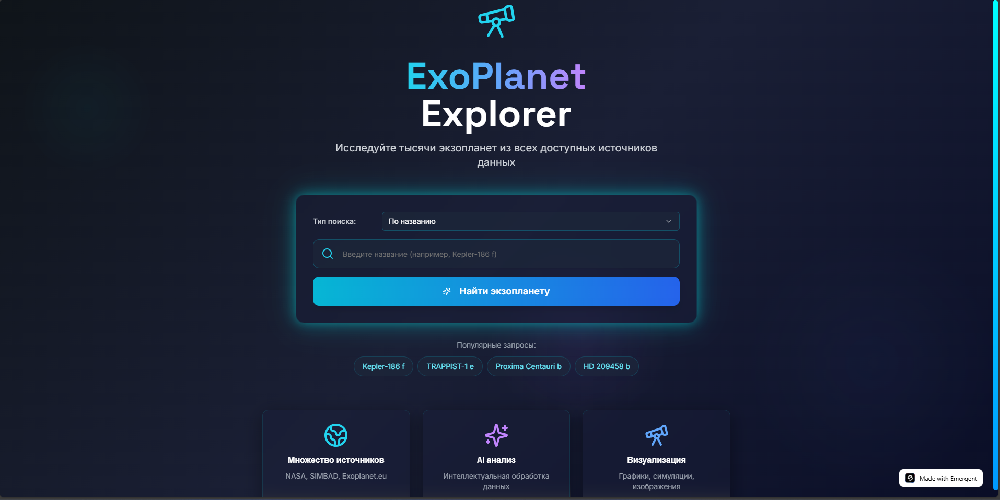

# 🪐 ExoVision — исследователь экзопланет



> **Поиск. Анализ. Визуализация.**
> ExoVision собирает максимум доступной информации о каждой из ~6300 подтверждённых экзопланет:
> композитные данные NASA, SIMBAD, Wikipedia, реальные снимки неба и AI-анализ.

---

## ✨ Возможности

| Функция | Описание |
|--------|--------|
| **⚡ Мгновенный поиск** | Локальный каталог всех планет NASA: автодополнение, поиск по имени/звезде/TIC ID |
| **🗂️ Каталог с фильтрами** | Размер, температурная зона, метод и год открытия, расстояние, сортировка |
| **📊 Максимум данных** | Композитная таблица `pscomppars` (400+ полей), ошибки измерений, SIMBAD, псевдонимы, Wikipedia |
| **🌱 Обитаемость v2** | 7 факторов, зона обитаемости Коппарапу (2013), ESI, приливный захват, риски и рекомендации |
| **🧮 Производные величины** | Гравитация, 2-я космическая, плотность, инсоляция, время полёта до системы |
| **🛰️ Реальные снимки неба** | Поле звезды из DSS2 / 2MASS / AllWISE (CDS hips2fits) + интерактивный атлас Aladin |
| **🎨 Художественные портреты** | Планета и звезда генерируются по измеренным параметрам (PIL/numpy) |
| **📈 Визуализации** | Живая canvas-анимация орбиты, интерактивный график масса-радиус, matplotlib-панели |
| **⚖️ Сравнение планет** | Любые две планеты бок о бок: факторы, параметры, вердикт |
| **🤖 AI-анализ (Ollama)** | Выбор локальной модели, полный разбор и ответы на свои вопросы |
| **🛰️ AI-детектор** | Своя ML-модель (ROC-AUC 0.994 на размеченных KOI Kepler; переносимая lite 0.982 ранжирует живых кандидатов TESS) — [как устроено](AI-DETECTOR.md) · [тех. отчёт](TECH-REPORT.md) · [обзор области](RESEARCH-CONTEXT.md) · [фишки и валидация](PROJECT-HIGHLIGHTS.md) |
| **📉 Кривые блеска** | Скачивание реальных данных TESS/Kepler из MAST, фолдинг, проверки вэттинга + нейросеть формы транзита |
| **💾 Экспорт** | Полный JSON и все изображения в один клик |

## 🛠️ Технологии

```text
Backend:  Python 3.10+ | FastAPI | httpx | Pillow | matplotlib | numpy | Motor (опционально)
ML:       scikit-learn (классификатор KOI + нейросеть формы транзита) | lightkurve (кривые блеска MAST)
Frontend: React 18 | Tailwind CSS | Framer Motion | Recharts | shadcn/ui | Lucide
AI:       Ollama (любая локальная модель: gemma3, llama3, qwen…)
Данные:   NASA Exoplanet Archive (TAP) | SIMBAD (TAP) | Wikipedia REST | CDS hips2fits | NASA Alias Lookup | MAST
```

### Обучение ML-моделей (уже обучены, файлы в `backend/models/`; переобучение по желанию)

```bash
cd backend
python train_model.py       # классификатор (полный 23 + переносимый lite 12) на ~9600 KOI Kepler
python collect_lc_v3.py     # скачать реальные кривые Kepler из MAST (с чекпойнтами)
python train_lc_torch.py    # двухветочная CNN формы транзита на 24 000 синтетики + 9 467 реальных
```

## ⚡ Установка

### Windows: одна команда

После установки зависимостей (шаги 2–3 ниже, единожды) запускайте всё двойным кликом по **`start.bat`** —
он поднимет backend и frontend и откроет браузер.

### Тесты

```bash
cd backend
python -m pytest test_smoke.py -q   # 20 быстрых проверок физики, скоринга и поиска
```

### 1. Клонируйте репозиторий

```bash
git clone https://github.com/root3315/TIC-id.git
cd TIC-id
```

### 2. Запустите бэкенд

```bash
cd backend
pip install -r requirements.txt
uvicorn server:app --reload --port 8001
```

MongoDB не обязателен: без него история хранится в памяти процесса.

### 3. Запустите фронтенд

```bash
cd ../frontend
npm install
npm start
```

### 4. (Опционально) AI-анализ

```bash
ollama pull gemma3   # или любая другая модель
```

## 📡 API

| Метод | Эндпоинт | Описание |
| ------ | -------- | -------- |
| `POST` | `/api/search` | Поиск: точное имя → полные данные, иначе список совпадений |
| `GET` | `/api/planet/{name}` | Полные данные по планете (для прямых ссылок) |
| `GET` | `/api/suggest?q=` | Мгновенное автодополнение |
| `GET` | `/api/catalog?…` | Каталог с фильтрами и пагинацией |
| `GET` | `/api/stats` | Статистика архива (для главной) |
| `GET` | `/api/random` | Случайная планета |
| `GET` | `/api/compare?planet1=&planet2=` | Сравнение двух планет |
| `GET` | `/api/history` | Последние запросы |
| `GET` | `/api/ollama/models?url=` | Список локальных моделей Ollama |
| `POST` | `/api/analyze` | AI-анализ (модель и свой вопрос — опционально) |
| `GET` | `/api/habitability/{name}` | Только оценка обитаемости |
| `GET` | `/api/ml/info` | Метрики и устройство ML-моделей |
| `POST` | `/api/ml/classify` | Вероятность «планета vs ложноположительный» по параметрам |
| `GET` | `/api/ml/toi` | Живые кандидаты TESS, ранжированные моделью |
| `GET` | `/api/lightcurve?target=&period=` | Реальная кривая блеска + фолдинг + вердикты |

## 📜 Лицензия

[MIT License](LICENSE)

## 👨‍💻 Автор

**Stepan Ionichev**
GitHub: [@root3315](https://github.com/root3315) · Telegram: [@Pumpkin2008](https://t.me/@Pumpkin2008)

> **ExoVision** — не просто каталог. Это инструмент для будущих колонизаторов и исследователей космоса. 🌌
