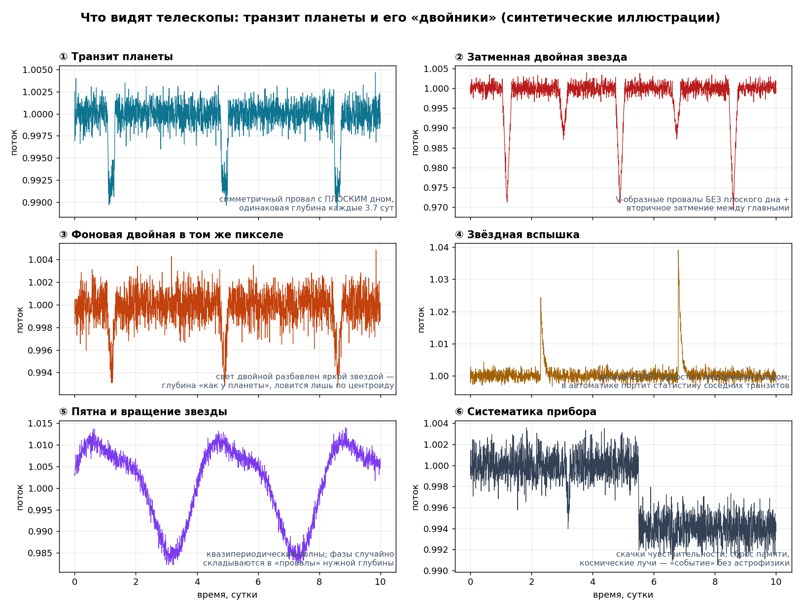

# Контекст исследования: как ищут экзопланеты, почему без ИИ уже нельзя, и что сделано до нас

> Раздел командного отчёта (материал для «обзорной» части). Иллюстрация ниже генерируется
> скриптом `backend/make_confusion_figure.py`; список литературы содержит 28 работ с рабочими ссылками.

---

## 1. Как сегодня ищут экзопланеты

| Метод | Идея | Доля открытий |
|---|---|---|
| **Транзитный** (наш) | планета проходит по диску звезды → яркость падает на доли процента со строгим периодом | ~75% всех планет (Kepler, K2, TESS) |
| Лучевые скорости (Доплер) | планета качает звезду → линии спектра смещаются | ~19% |
| Микролинзирование | гравитация системы усиливает свет фоновой звезды | ~1.5% |
| Прямые снимки | планету видно рядом с закрытой коронографом звездой | <1%, только молодые гиганты |
| Астрометрия и др. | смещение звезды на небе | единичные |

Транзитный метод приносит больше всего открытий, но вместе с ними и больше всего **ложных
тревог**. Ведь сам сигнал сводится к провалу яркости на 0.01–1%, а такой провал умеют
имитировать десятки посторонних явлений.

## 2. Почему потоки данных невозможно обработать вручную

Масштаб фотометрических обзоров:

- **Kepler** четыре года без перерыва снимал ~200 000 звёзд каждые 30 минут, а это миллиарды
  измерений. Автоматический поиск выдал **34 032 «события»** (TCE) в одном только финальном
  релизе DR25 ([Thompson et al. 2018](https://arxiv.org/abs/1710.06758)), и каждое из них надо
  проверять.
- **TESS** с 2018 года каждые ~27 суток снимает новый сектор неба целиком: полнокадровые
  изображения (сначала каждые 30 мин, теперь каждые 200 с) плюс ~20 000 избранных звёзд
  с 2-минутной каденцией. Набегают **сотни гигабайт фотометрии в месяц** и уже **>7 000
  кандидатов TOI**, очередь которых растёт быстрее, чем её успевают проверять.
- Проверка одного кандидата вручную сводится к осмотру сложенной кривой, теста «чёт/нечёт»,
  вторичного затмения, центроида, соседних звёзд. На тысячи кандидатов уходят **человеко-годы**.

Есть ещё и **человеческий фактор**: усталость и субъективность. Показательно, что
проверяющие расходятся во мнениях как раз на слабых сигналах, там, где и прячутся маленькие
планеты. В итоге проект Kepler заменил людей роботом-вэттером, чтобы каталог был хотя бы
*воспроизводим*
([Coughlin et al. 2016 / Robovetter](https://ui.adsabs.harvard.edu/abs/2020ascl.soft12006C/abstract)).

## 3. С чем путают транзиты планет (и почему)

| Явление | Чем похоже | Как отличают |
|---|---|---|
| **Затменная двойная звезда** | тот же периодический провал | острая V-форма (без широкого U-образного дна планеты), вторичное затмение на фазе 0.5, разная глубина чёт/нечёт |
| **Фоновая затменная двойная** в том же пикселе | её глубокое затмение «разбавляется» светом яркой звезды и становится маленьким, «планетным» | смещение центра яркости (центроида) во время события |
| **Звёздная вспышка** | резкое *событие* в кривой; при автоматическом поиске портит статистику и маскирует/имитирует транзиты | вспышка направлена **вверх** и асимметрична (резкий взлёт, медленный спад) |
| **Пятна и вращение звезды** | квазипериодические волны яркости складываются в «провалы» | форма синусоидальна, период дрейфует, глубина «дышит» |
| **Систематика прибора** | скачки чувствительности, сбросы, космические лучи | привязка к событиям на борту, не повторяется со строгим периодом |

Из-за этой путаницы «нашёл провал» ещё не значит «нашёл планету». Поэтому задача давно
превратилась в классическую задачу машинного обучения.

## 4. Что уже сделано до нас: обзор литературы (28 работ)

**Классический фундамент**
1. Kovács, Zucker & Mazeh 2002 — алгоритм **BLS**, стандарт поиска транзитов — [arXiv:astro-ph/0206099](https://arxiv.org/abs/astro-ph/0206099)
2. McCauliff et al. 2015 — **Autovetter**: случайный лес для TCE Kepler — [ADS](https://ui.adsabs.harvard.edu/abs/2015ApJ...806....6M/abstract)
3. Coughlin et al. 2016 — **Robovetter**: экспертная система, каталог DR24 — [ASCL/ADS](https://ui.adsabs.harvard.edu/abs/2020ascl.soft12006C/abstract)
4. Thompson et al. 2018 — финальный каталог Kepler DR25 с измеренной полнотой/надёжностью — [arXiv:1710.06758](https://arxiv.org/abs/1710.06758)
5. Armstrong et al. 2017 — самоорганизующиеся карты (SOM) для ранжирования кандидатов — [обзор с описанием](https://www.researchgate.net/publication/331769490_Machine-learning_approaches_to_exoplanet_transit_detection_and_candidate_validation_in_wide-field_ground-based_surveys)

**Эра свёрточных сетей (Kepler/K2)**
6. Shallue & Vanderburg 2018 — **AstroNet**: CNN на «глобальном+локальном виде», открытие Kepler-90 i — [arXiv:1712.05044](https://arxiv.org/abs/1712.05044)
7. Ansdell et al. 2018 — ExoNet: CNN + доменные знания (центроиды, параметры звезды) — [arXiv:1810.13434](https://arxiv.org/abs/1810.13434)
8. Chaushev et al. 2019 — CNN для наземного обзора NGTS — [arXiv:1907.11109](https://arxiv.org/abs/1907.11109)
9. Schanche et al. 2019 — ML для наземных широкопольных обзоров (WASP) — [Request PDF](https://www.researchgate.net/publication/331769490_Machine-learning_approaches_to_exoplanet_transit_detection_and_candidate_validation_in_wide-field_ground-based_surveys)
10. Caceres et al. 2019 — авторегрессионный поиск планет (ARPS) — [arXiv:1901.05116](https://arxiv.org/abs/1901.05116)

**Валидация планет машинным обучением**
11. Armstrong, Gamper & Damoulas 2020 — первая ML-**валидация**: 50 новых планет Kepler — [MNRAS](https://academic.oup.com/mnras/article/504/4/5327/5894933)
12. Valizadegan et al. 2022 — **ExoMiner**: глубокая сеть, копирующая тесты экспертов; валидированы 301 планета — [arXiv:2111.10009](https://arxiv.org/abs/2111.10009)
13. Valizadegan et al. 2023 — Multiplicity Boost: +69 валидированных планет — [arXiv:2305.02470](https://arxiv.org/abs/2305.02470)

**Эра TESS**
14. Yu et al. 2019 — Astronet-Triage/Vetting для TESS (QLP) — [AJ/IOP](https://iopscience.iop.org/article/10.3847/1538-3881/ab21d6)
15. Osborn et al. 2020 — быстрая классификация кандидатов TESS свёрточными сетями — [arXiv:1902.08544](https://arxiv.org/abs/1902.08544)
16. Magliano et al. 2022 — TESS Triple-9: 999 единообразно проверенных кандидатов — [arXiv:2203.15826](https://arxiv.org/abs/2203.15826)
17. Tey et al. 2023 — **Astronet-Triage-v2**: recall 99.6% на FFI-кривых — [arXiv:2301.01371](https://arxiv.org/abs/2301.01371)
18. Valizadegan et al. 2025 — **ExoMiner++**: transfer learning Kepler→TESS, 7 330 кандидатов — [arXiv:2502.09790](https://arxiv.org/abs/2502.09790) · [AJ](https://iopscience.iop.org/article/10.3847/1538-3881/ae03a4)
19. ExoMiner++ 2.0 (2026) — вэттинг сигналов полнокадровых изображений TESS — [arXiv:2601.14877](https://arxiv.org/html/2601.14877v2)
20. LEO-Vetter 2025 — полностью автоматический флюкс- и пиксель-вэттинг TESS — [arXiv:2509.10619](https://arxiv.org/html/2509.10619v1)
21. RAVEN 2025 — ранжирование и валидация кандидатов — [arXiv:2509.17645](https://arxiv.org/html/2509.17645)

**Свежие направления (2025–2026)**
22. ExoNet (2026) — мультимодальная сеть с attention: кривая + параметры звезды — [arXiv:2604.15560](https://arxiv.org/html/2604.15560)
23. TransitNet (2026) — компактный attention-детектор слепого поиска при низком SNR — [arXiv:2606.18932](https://arxiv.org/pdf/2606.18932)
24. ExoVeil (2026) — детекция по **одному** транзиту через выученное поведение звезды — [arXiv:2606.02778](https://arxiv.org/html/2606.02778)
25. Instrument-agnostic prioritization (2026) — приоритизация кандидатов без привязки к прибору — [arXiv:2606.07769](https://arxiv.org/html/2606.07769)
26. CNN+RNN для Kepler DR25 (2025) — [arXiv:2509.04793](https://arxiv.org/pdf/2509.04793)
27. Обучение на синтетических кривых (2025) — [arXiv:2507.19520](https://arxiv.org/pdf/2507.19520); смесь реальных и синтетических данных (2022) — [Sci. Reports/PMC](https://pmc.ncbi.nlm.nih.gov/articles/PMC9132280/)
28. Обзоры области: Jara-Maldonado et al. 2020 — [Earth Sci. Informatics](https://link.springer.com/article/10.1007/s12145-020-00464-7); «Luminis Stellarum»: ML в анализе кривых блеска (2025) — [arXiv:2504.10038](https://arxiv.org/pdf/2504.10038); CNN для транзитной фотометрии (2025) — [Sci. Reports](https://www.nature.com/articles/s41598-025-98935-8)

## 5. Как наше решение закрывает эти проблемы

1. **Автоматизация вэттинга.** Тот же класс задач, что у Robovetter/ExoMiner, только наша
   система обучается и работает **на обычном ноутбуке без GPU** (тогда как ExoMiner++ живёт на
   кластерах NASA).
2. **Два независимых уровня.** Табличная физика (бустинг, ROC-AUC 0.994) и форма сигнала
   (нейросеть на «локальном виде», по идее AstroNet), плюс классические проверки. Чтобы пройти,
   ложная тревога должна обмануть всё сразу.
3. **Объяснимость.** Для каждого вердикта видны вклад признаков и сравнение с медианами
   классов, так что человек остаётся в цикле принятия решения.
4. **Применение к живой очереди.** Модель ранжирует 5 363 непроверенных кандидата TESS,
   к каждому идёт ссылка на ExoFOP. Это прямой ответ на «очередь растёт быстрее, чем
   проверяется».
5. **Полная воспроизводимость.** Открытый код, метрики считаются автоматически, 20 юнит-тестов,
   и любая цифра отчёта повторяется одной командой.

Технические детали и метрики собраны в [TECH-REPORT.md](TECH-REPORT.md), а популярное описание
в [AI-DETECTOR.md](AI-DETECTOR.md).
