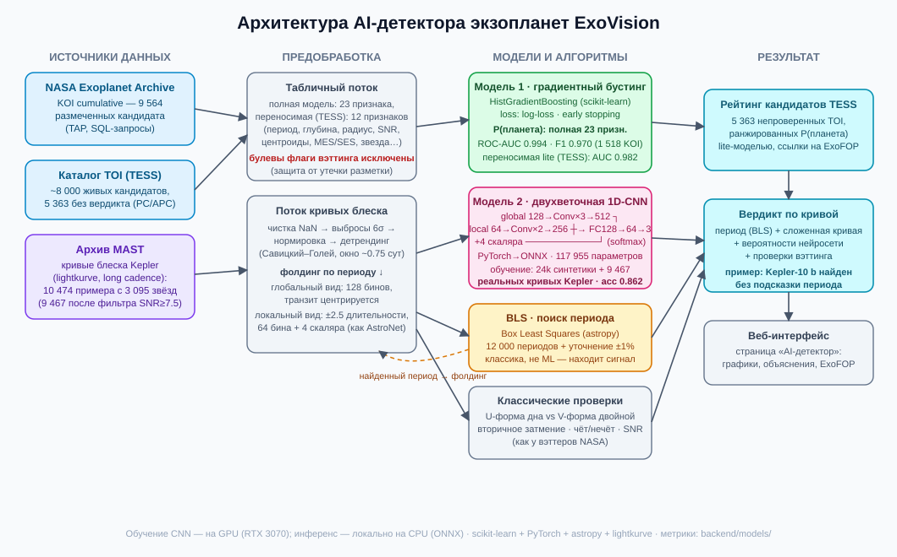
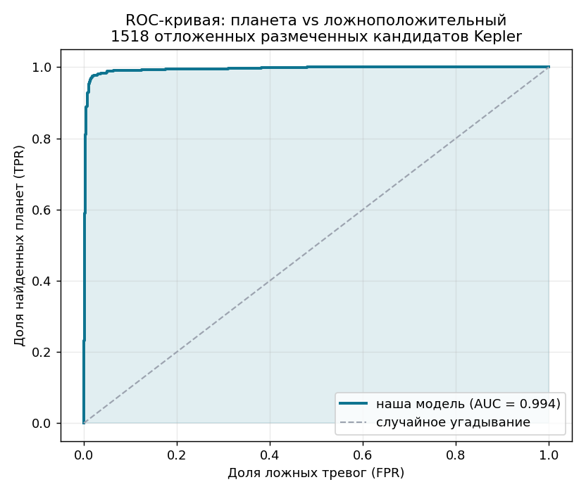
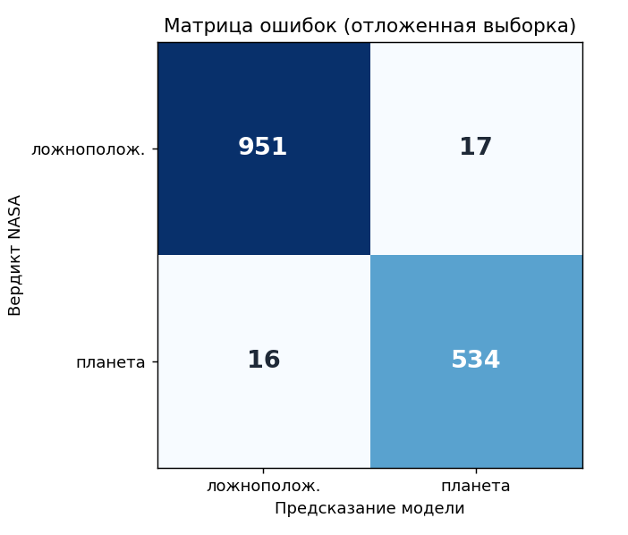
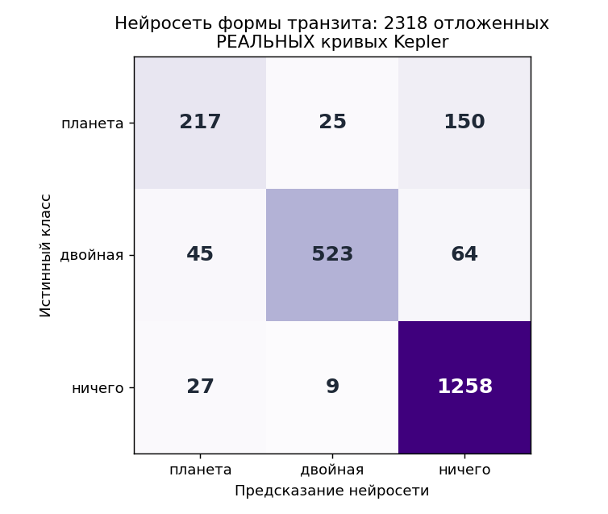

# Технический отчёт: как устроен и обучен AI-детектор экзопланет

> Раздел проекта ExoVision. Все цифры в этом документе реальные: они автоматически
> генерируются кодом обучения (`backend/train_model.py`, `backend/train_lc_torch.py`) и
> проверки (`backend/eval_model.py`) и лежат в `backend/models/*_meta.json` и
> `docs/metrics_summary.json`. Любую цифру можно воспроизвести одной командой.

---

## 1. Архитектура ИИ

### Общая схема



Система устроена как **гибридный пайплайн из двух моделей машинного обучения и одного классического
алгоритма**, работающий полностью локально:

| Блок | Что это | Вход | Выход |
|---|---|---|---|
| Модель 1 | Градиентный бустинг деревьев (`HistGradientBoostingClassifier`, scikit-learn), два варианта: полный (23 признака, для KOI) и переносимый lite (12, для TESS/ручного ввода) | табличные признаки кандидата | вероятность «это планета» |
| Модель 2 | **Двухветочная 1D-CNN** (AstroNet-подобная, PyTorch → ONNX, 117 955 параметров) | глобальный вид 128 бинов + локальный вид 64 бина + 4 скаляра | планета / затменная двойная / нет транзита |
| BLS | Box Least Squares (astropy), классика, не ML | сырая кривая блеска | период транзита + значимость (SDE) |
| Вэттинг-проверки | правила, как у экспертов NASA | сложенная кривая | V-форма, вторичное затмение, чёт/нечёт |

### Архитектура CNN: как в AstroNet, обучена на нашей GPU

Модель формы построена как **двухветочная 1D-свёрточная сеть** (схема AstroNet, Shallue & Vanderburg 2018):

```
Глобальная ветка (вход 1×128):
  Conv1d(16,k5) → MaxPool → Conv1d(32,k5) → MaxPool → Conv1d(64,k3) → GAP(8) = 512
Локальная ветка (вход 1×64):
  Conv1d(16,k5) → MaxPool → Conv1d(32,k3) → GAP(8) = 256
Голова:
  concat(512 + 256 + 4 скаляра) → FC128 → Dropout 0.35 → FC64 → 3 класса (softmax)
```

Глобальная ветка «видит» вторичные затмения на краях фазы (признак двойной звезды), локальная
отвечает за форму дна транзита. Старый MLP оставлен как fallback: сервер сам берёт CNN из ONNX,
если файл есть.

LSTM и трансформеры для рядов лучевых скоростей (метод Доплера) в системе **не используются**. Мы
работаем только с транзитной фотометрией, и это честно указано в ограничениях.

Смысл всего пайплайна в том, что тут **два независимых «мнения»** (табличная физика плюс форма
сигнала) и сверху классические проверки. Ложноположительный кандидат должен обмануть все три
уровня сразу.

---

## 2. Сбор и предобработка данных

### Откуда данные (все источники открытые, без ключей)

| Источник | Способ доступа | Что берём | Объём |
|---|---|---|---|
| NASA Exoplanet Archive, таблица `cumulative` (KOI) | TAP-запросы (SQL по HTTPS) | размеченные кандидаты Kepler: 23 признака + вердикт | **9 564** объекта: 2 747 CONFIRMED, 4 839 FALSE POSITIVE, 1 978 CANDIDATE (исключены) |
| NASA Exoplanet Archive, `pscomppars` | TAP | параметры всех подтверждённых планет | 6 316 |
| NASA Exoplanet Archive, `toi` | TAP | живые кандидаты TESS для применения модели | ~8 000, из них 5 363 без вердикта |
| Архив MAST | библиотека `lightkurve 2.6`, сборщик `collect_lc_v3.py` | реальные кривые блеска Kepler (long cadence) | **10 474 примера с 3 095 звёзд** (9 467 после фильтра SNR≥7.5) + любые по запросу пользователя |

Точные SQL-запросы лежат в `backend/train_model.py`; сбор кривых блеска, в `backend/collect_lc_v3.py`. Чтобы метки
были чистыми, класс «затменная двойная» собирался только из FALSE POSITIVE с флагом `koi_fpflag_ss = 1`
(затмение звездой подтверждено фотометрически, а не по смещению центроида).

### Очистка кривых от космического и приборного шума

Конвейер предобработки (файлы `backend/server.py`, `backend/lc_common.py`), в порядке применения:

1. **Склейка сегментов**: до 6 кварталов/секторов одной звезды объединяются (`stitch()`),
   каждый нормируется на свою медиану, так убираются скачки чувствительности между кварталами.
2. **Удаление NaN** и **выбросов** (обрезка по 6σ): космические лучи, глитчи детектора.
3. **Детрендинг**: фильтр Савицкого–Голея с окном ~0.75 суток убирает медленную звёздную
   переменность (пятна, вращение), не трогая короткие транзиты.
4. **Фолдинг** по периоду и **биннирование**: глобальный вид собирается из 128 фазовых бинов (медиана точек
   в бине давит белый шум в √N раз), транзит автоматически центрируется.
5. **Локальный вид**: окно ±2.5 длительности транзита, 64 бина, они и идут на вход нейросети.
6. **Оценка шума**, робастная (MAD по внетранзитным бинам), чтобы одиночные выбросы её не портили.

---

## 3. Процесс обучения

### Железо

| | |
|---|---|
| Процессор | Intel Core i7-11370H, 4 ядра / 8 потоков, 3.3 ГГц |
| Память | 16 ГБ |
| Видеокарта | **NVIDIA GeForce RTX 3070 Laptop**, обучение CNN (PyTorch 2.5 + CUDA 12.1) |
| ОС / стек | Windows 11 · Python 3.10 · scikit-learn 1.7 · PyTorch 2.5 · onnxruntime 1.23 · astropy 6.1 · lightkurve 2.6 |

GPU нужен **только для обучения CNN** (минуты). Инференс идёт через ONNX на CPU, так что
готовое приложение работает на любом ноутбуке без видеокарты.

### Функции потерь и настройки

| Модель | Loss | Оптимизация | Регуляризация |
|---|---|---|---|
| Градиентный бустинг | **log-loss** (биномиальная кросс-энтропия) | RandomizedSearchCV: 30 конфигураций × 5-fold; лучшая: lr 0.12, max_leaf_nodes 127 | L2 + **early stopping** |
| CNN формы транзита | **категориальная кросс-энтропия** + label smoothing 0.05 | **AdamW**, lr 1.5·10⁻³, cosine-схема, батч 512, до 60 эпох | Dropout 0.35, weight decay 10⁻⁴, **early stopping** по реальной валидации |

### Время обучения (замерено)

| Этап | Время |
|---|---|
| KOI (23 признака) + подбор гиперпараметров (150 + 100 обучений) + полная и lite-модели | ~18 мин |
| Скачивание кривых 3 095 звёзд Kepler из MAST (10 474 примера, сборщик v3 с чекпойнтами) | ~5 ч (сеть) |
| Генерация 24 000 синтетических примеров + **обучение CNN на RTX 3070** + экспорт ONNX | **~1.5 мин** |

Обучающая смесь CNN v3: 24 000 синтетических двухветочных примеров + 5 909 реальных (×6 повторов).
Валидация и тест считаются **только на отложенных реальных** кривых (1 240 и 2 318 соответственно),
причём деление идёт по звёздам, а не по отдельным кривым.

---

## 4. Метрики качества

Все метрики посчитаны на **отложенных выборках, которые модель не видела при обучении**
(фиксированный `random_state`, значит, результаты воспроизводимы; скрипт `backend/eval_model.py`).

### Модель 1: планета vs ложноположительный (1 518 реальных размеченных KOI)

Версия v2: 23 признака (добавлены диагностические, смещение центроида, статистики
MES/SES, Rp/R★, a/R★ и др., те же величины, что смотрят вэттеры NASA) плюс подбор
гиперпараметров RandomizedSearchCV (30 конфигураций × 5-fold, CV ROC-AUC 0.996).

| Метрика | v1 (12 признаков) | **v2 (23 признака + CV)** | v2-lite (12 переносимых) |
|---|---|---|---|
| **ROC-AUC** | 0.983 | **0.994** | 0.982 |
| Accuracy | 0.939 | **0.978** | 0.937 |
| Precision | 0.906 | **0.969** | 0.908 |
| Recall | 0.927 | **0.971** | 0.920 |
| **F1-score** | 0.916 | **0.970** | 0.914 |

Зачем два варианта. Диагностические признаки v2 (центроиды, MES/SES) существуют **только в
пайплайне Kepler**: у кандидатов TESS и в ручной форме их нет, и полная модель на таких данных
занижает вероятности (мы поймали это на живом рейтинге TOI). Поэтому полная модель отвечает за
метрики и анализ KOI, а **v2-lite на 12 миссия-независимых признаках** идёт на рейтинг TOI и ручную
проверку. Обе обучаются одной командой и лежат в одном паспорте `model_meta.json`.

ROC-кривая:



Матрица ошибок (строки — вердикт NASA, столбцы — предсказание):



|  | предсказано: ложное | предсказано: планета |
|---|---|---|
| **NASA: ложное** (968) | 951 | 17 |
| **NASA: планета** (550) | 16 | **534** |

Читается так: из 550 настоящих планет модель нашла 534 (97.1%), а среди объектов, названных ею
планетами, ошибалась лишь в ~3% случаев.

### Модель 2: CNN формы транзита (отложенные РЕАЛЬНЫЕ кривые Kepler)

| Метрика | MLP v1 | CNN v2 | **CNN v3 (текущая)** |
|---|---|---|---|
| Реальных примеров в датасете | 240 | 1 000 | **9 467** (из 10 474 собранных; фильтр SNR ≥ 7.5) |
| Отложенный реальный тест | 60 | 250 | **2 318** (разбиение по звёздам, KIC-grouped) |
| Accuracy на реальном тесте | 0.767 | 0.900 | **0.862** |
| F1 (macro) | 0.755 | 0.886 | **0.809** |
| Accuracy на «лёгком» тесте из 250 | — | 0.896 | 0.920 |
| Accuracy на синтетическом тесте | ~0.94 | 0.996 | 0.999 |

Важно про разбиение. Тест и обучение делятся **по звёздам** (KIC-grouped): все кривые одной
звезды идут целиком либо в обучение, либо в тест, никогда в оба сразу. Так между наборами нет
утечки, и цифра 0.862 честная. Именно так делят выборку AstroNet и ExoMiner. Данные хранят
пометку звезды (`collect_lc_v3.py` пишет её, `train_lc_torch.py` по ней и делит).



Разбор матрицы честно, по классам (2 318 отложенных реальных кривых, тест по звёздам):

| Истинный класс | Всего | Верно (recall) | Куда уходят ошибки |
|---|---|---|---|
| Планета | 392 | 217 (**55%**) | 25 → «двойная», 150 → «шум» |
| Двойная | 632 | 523 (**83%**) | 45 → «планета», 64 → «шум» |
| Нет транзита | 1 294 | 1 258 (**97%**) | 27 → «планета», 9 → «двойная» |

Что тут стоит увидеть без прикрас:
- **«Планета ↔ двойная» модель почти не путает**: лишь 25 из 392 планет уходят в «двойную»
  (~6%). Именно это различие отделяет открытие от ложной тревоги, и здесь модель сильна.
- **А вот recall планет всего 55%**: 150 планет из 392 модель называет «шумом». Причина
  методическая. В v3 бралось до 2 сегментов на звезду (один квартал данных), и у планет со
  слабым сигналом транзит в одном квартале физически не разрешается. Общую accuracy 0.862
  заметно поднимает лёгкий класс «нет транзита» (recall 97%, 56% теста), поэтому её нельзя
  читать как «точность обнаружения планет»: реальный recall планет ниже, и мы это не прячем.

### Контрольный пример на реальных данных

Вход: имя **Kepler-10**, период не сообщается. Пайплайн: 170 469 реальных точек из MAST,
BLS находит период **0.837425 сут** (опубликованный: 0.837495, ошибка 0.008%), нейросеть говорит
«планетный транзит», глубина 158 ppm (опубликованная ~152), длительность 1.73 ч (~1.8).
Первая каменная планета Kepler переоткрыта системой из сырых данных.

---

## Ограничения (обязательный раздел)

- **Перенос Kepler→TESS не измерен на TESS.** lite-модель (12 признаков) тестировалась на
  Kepler-холдауте (ROC-AUC 0.982); прямой метрики качества на размеченных TESS-объектах пока нет,
  поэтому вероятности TOI-рейтинга работают как приоритизация, а не как подтверждённая точность.
- **Центроидные признаки — палка о двух концах.** Смещение центроида (`koi_dikco_msky` и др.)
  в полной модели входит в число самых весомых признаков, и он частично кодирует сам вердикт NASA о
  фоновой двойной (квази-утечка: полную модель поэтому честно применяем только к данным Kepler,
  а не к сырым кандидатам). У TESS этих признаков нет вовсе (работает lite без центроидов), а
  именно фоновые двойные и есть главный источник ложных TESS-кандидатов.
- Табличная модель обучена на статистике Kepler, поэтому на кандидатах TESS работает переносом
  (для этого сделана отдельная lite-модель на миссия-независимых признаках, но перенос остаётся приближением).
- Слабые сигналы (SNR ниже ~7 в сложенной кривой) система честно помечает как ненадёжные:
  маленькие планеты у тусклых звёзд по одному сегменту данных не разрешаются (recall планет 55%).
- Метод один, транзиты; лучевые скорости, микролинзирование и прямые снимки не покрываются.
- Вероятность модели нужна для приоритизации проверки, а не как факт открытия.

## Воспроизведение всех цифр

```bash
cd backend
python train_model.py       # обучить бустинг (полный + lite) на свежем KOI, напечатать метрики
python collect_lc_v3.py     # скачать реальные кривые Kepler из MAST (с чекпойнтами)
python train_lc_torch.py    # обучить CNN формы на RTX 3070, экспорт в ONNX
python eval_model.py        # Accuracy/Precision/Recall/F1/ROC + все графики в docs/
python -m pytest test_smoke.py -q   # 20 быстрых тестов физики и скоринга
```

Смежные документы: [AI-DETECTOR.md](AI-DETECTOR.md), популярное описание системы,
таблица «что реально / что синтетика / что оценка» и примеры использования.
